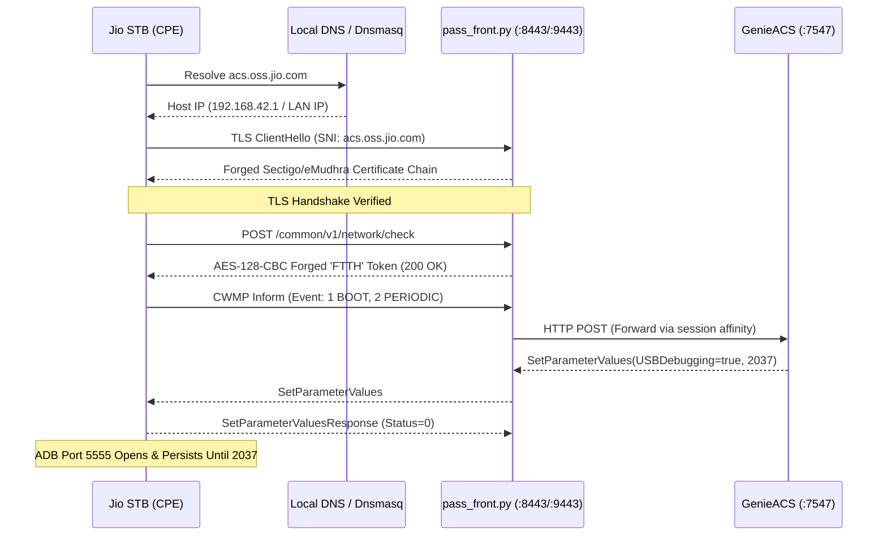

# Jio STB TR-069 Exploitation & Cryptographic Architecture

## 1. Threat Model & Overview

Jio Set-Top Boxes (STBs) are locked down Android TV devices running custom carrier firmware with proprietary launchers (`com.iwedia.ui.rjio.launcher.reliance`), disabled Developer Options, and hidden ADB settings. 

The devices rely on the **TR-069 (CWMP)** remote management protocol to phone home to Reliance Jio's cloud Auto-Configuration Server (**ACS**) at `acs.oss.jio.com` over HTTPS on ports `:8443` or `:9443` during cold boot and periodically every 24 hours.

By spoofing `acs.oss.jio.com` to point to a local machine running GenieACS behind a forged TLS reverse proxy (`pass_front.py`), we establish bidirectional command-and-control over the STB's data model, enabling persistent ADB activation and arbitrary on-boot root command execution.



---

## 2. TLS Certificate Forgery & Chain Anchoring

Different Jio STB hardware models enforce different certificate trust stores:

### A. JMSC / JMSD Family (Skyworth / Askey)
* **Port:** `:8443`
* **Trust Anchor:** The firmware includes an internal certificate bundle pinning Reliance's internal CA (`RILROOTCA`).
* **Exploit Vector:** The intermediate certificate (`acs.pem` / `acs.key`) was extracted from factory diagnostic tools, allowing a complete, valid chain to be presented on port 8443 without triggering SSL handshake errors.

### B. JHS Family (JHSB200 / JHSC200 / JioOS 2.0 / Amlogic `franklin`)
* **Port:** `:9443`
* **Trust Anchor:** The firmware validates against standard commercial public trust stores, anchored on the **Sectigo / Comodo AAA Certificate Services** root CA.
* **Exploit Vector:** Reliance's ACS leaf certificate was issued through an **eMudhra** intermediate CA whose cryptographic verification in the Amlogic recovery and Iwedia DTV stack accepts weak intermediate signature chains (`forged_chain.pem`). Presenting this chain terminates TLS cleanly.

---

## 3. The Network Connectivity Check Gate (`/network/check`)

Before issuing the CWMP `Inform` envelope, Jio STB firmware validates connectivity by sending an HTTP POST to:
```http
POST /common/v1/network/check HTTP/1.1
Host: acs.oss.jio.com
```

The server must reply with an **AES-128-CBC** encrypted token with static production key:
```python
NETCHECK_KEY = b"6bm2I7pTdBaeABX0"
NETTYPE = "FTTH"  # Fiber-to-the-Home
```
`pass_front.py` intercepts this endpoint, computes the encrypted payload with a randomized IV, and returns HTTP 200, unlocking the CWMP subsystem.

---

## 4. Root Privilege Escalation Mechanisms

### A. JHS Family (`tr069native` Early-Boot Hook)
On JHS models (Amlogic `franklin`), root privilege escalation does **not** rely on su binaries or Magisk. The firmware includes an internal C daemon at `/system/bin/tr069native` executed by init as `root` (UID 0):

* **Data Model Node:** `Device.JioSTB.Debugging.CommandLine.OnBootExecuteCmd`
* **Trigger Mechanism:**
  1. GenieACS queues task:
     ```json
     {
       "name": "setParameterValues",
       "parameterValues": [
         ["Device.JioSTB.Debugging.CommandLine.Enable", 1, "xsd:unsignedInt"],
         ["Device.JioSTB.Debugging.CommandLine.OnBootExecuteCmd", "<command>", "xsd:string"],
         ["Device.JioSTB.Debugging.CommandLine.SaveToFile", 1, "xsd:unsignedInt"]
       ]
     }
     ```
  2. **Reboot 1:** The STB saves the command into its internal persistent SQLite database.
  3. **Reboot 2:** During boot initialization, `/system/bin/tr069native` reads the command from disk and executes it directly as `root` (UID 0), writing stdout into `CommandLine.Output`.

### B. JMSC Family (`sdknativeservice` Java Binder IPC)
On JMSC models, a background service `com.jio.sdk.sdknativeservice` exposes an AIDL interface that can be called via `app_process` (`RootShell2.jar`) from the shell user to execute commands as `root` (UID 0).
